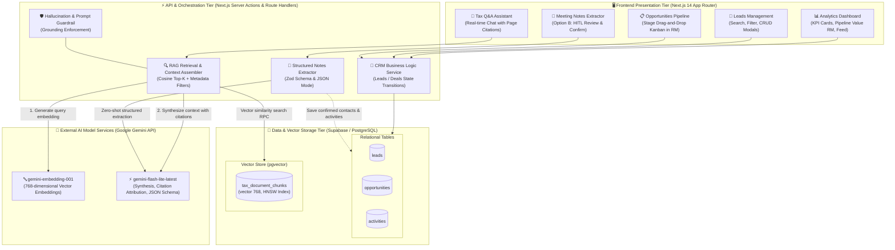
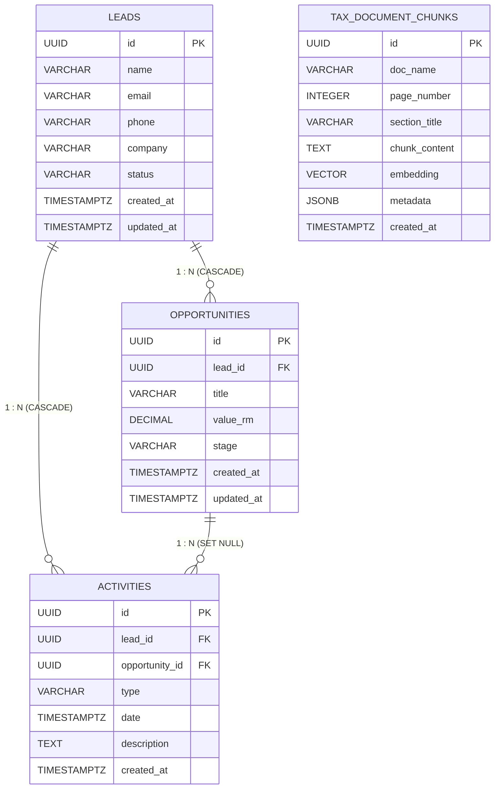

# System Architecture & Engineering Design
**Project:** YYC taxPOD CRM with AI Capabilities & Tax RAG Assistant  
**Author:** Abraham  
**Role Target:** Software Engineer (Full Stack & AI Integration)  
**Date:** November 2026  

---

## 1. System Component Diagram

The system adopts a modular, 3-tier cloud-ready architecture comprising a presentation client, an orchestration API layer, a dual relational/vector storage engine, and an external AI inference engine.



---

## 2. Data Model & Entity Relationship (ERD)

The data model cleanly separates standard CRM transactional entities (`leads`, `opportunities`, `activities`) from high-dimensional RAG vector storage (`tax_document_chunks`).



### Table Specifications
1. **`leads`**: Central contact registry. Status transitions track the customer lifecycle from cold lead to active paying client (`Lead` | `Prospect` | `Customer`).
2. **`opportunities`**: Deals pipeline with monetary amounts in Malaysian Ringgit (`value_rm`, `DECIMAL(12,2)`) grouped by Kanban stages (`New` | `Contacted` | `Qualified` | `Proposal` | `Won` | `Lost`). Foreign key `lead_id` cascades on deletion.
3. **`activities`**: Interaction trail (Call / Email / Meeting / Note) attached to leads or specific deals. Enables Option B (Meeting Notes Extractor) to log audit history.
4. **`tax_document_chunks`**: Document repository for RAG. Stores raw text snippets alongside 768-dimensional float embeddings generated by `gemini-embedding-001`. Indexed via `pgvector` HNSW (`vector_cosine_ops`).

---

## 3. AI Integration Design (RAG Pipeline)

### 3.1 Document Ingestion Pipeline
1. **Source Documents (5 Malaysian Official Tax Documents)**:
   - *LHDN e-Invoice Guideline (Version 3.0)*
   - *LHDN e-Invoice Specific Guideline*
   - *Royal Malaysian Customs Department (RMCD) - Guide on Service Tax 8%*
   - *RMCD - Guide on Low Value Goods (LVG) Sales Tax*
   - *LHDN Public Ruling on Withholding Tax / Capital Allowances*
2. **Parsing**: PDF text extraction preserving page boundaries (`page_number`) and structural headers (`section_title`).
3. **Chunking Strategy**:
   - **Chunk Size**: 800 tokens (~3,000 characters). Preserves complete statutory clauses and itemized rules.
   - **Chunk Overlap**: 150 tokens (~600 characters). Prevents semantic boundary cuts between sentences.
   - **Metadata Injection**: Each chunk is tagged with `{ doc_name, page_number, section_title }` before embedding.

### 3.2 Vector Storage & Retrieval
- **Embedding Model**: Google `text-embedding-004` (768 dimensions).
- **Vector Database**: Supabase PostgreSQL with `pgvector` extension.
- **Index Type**: Hierarchical Navigable Small World (`HNSW`) with cosine distance (`vector_cosine_ops`), providing $O(\log N)$ query latency:
  ```sql
  CREATE INDEX ON tax_document_chunks USING hnsw (embedding vector_cosine_ops);
  ```
- **Retrieval Logic**:
  - Convert user prompt into vector.
  - Execute PostgreSQL RPC function `match_tax_chunks(query_embedding, match_threshold, match_count)`.
  - Top-K setting: `K = 4` chunks, threshold similarity score $\ge 0.65$.

### 3.3 Prompt Engineering & Hallucination Guardrail
The prompt strictly enforces grounded answers and systematic citation:
```markdown
You are a senior Malaysian tax consultant assistant for YYC taxPOD.
Answer the user's question using ONLY the provided official context chunks.

RULES:
1. Every claim must have an inline citation tag: [Doc: <doc_name>, Page: <page_number>, Section: <section>].
2. If the answer cannot be found in the provided context, state:
   "The provided Malaysian tax documents do not contain information regarding this inquiry."
   DO NOT speculate or use external knowledge.
3. Maintain professional, concise Malaysian business English.
```

---

## 4. Option B Design: Meeting Notes Extractor (Human-in-the-Loop)

1. **Workflow**:
   ```mermaid
   sequenceDiagram
       actor User as Sales Rep
       participant UI as Notes Extractor Form
       participant Extractor as Gemini Structured Output
       participant Modal as Review & Confirm Modal
       participant DB as Database

       User->>UI: Paste raw meeting text
       UI->>Extractor: POST /api/ai/extract-notes
       Extractor-->>UI: Return validated JSON schema
       UI->>Modal: Populate editable review form
       Note over User, Modal: Human-in-the-Loop verification
       User->>Modal: Edits fields if needed & clicks "Confirm & Save"
       Modal->>DB: Atomically insert/update Lead, Opportunity, and Activity
       DB-->>UI: Success toast & update Kanban/Dashboard
   ```
2. **Schema Enforcement**:
   - Extraction is constrained using Zod / JSON Schema mode:
     ```json
     {
       "contactName": "string",
       "companyName": "string",
       "phone": "string",
       "opportunityTitle": "string",
       "dealValueRM": "number",
       "stage": "New | Contacted | Qualified | Proposal | Won",
       "activityNotes": "string",
       "nextActionDate": "string"
     }
     ```

---

## 5. Technology Stack Justification

| Layer | Chosen Technology | Architectural Justification |
| :--- | :--- | :--- |
| **Full Stack Framework** | **Next.js 14 (App Router, TypeScript)** | Industry standard for modern SaaS. Server Components reduce bundle size; Server Actions / Route Handlers provide clean API encapsulation without separate backend boilerplate. |
| **UI & Styling** | **Tailwind CSS + shadcn/ui + Lucide Icons** | Delivers accessible, clean, production-grade UI design with minimal CSS overhead. Essential for polished Kanban and data tables. |
| **Database & Vectors** | **Supabase (PostgreSQL + pgvector)** | Directly matches the assessment brief's preferred choice. Combines relational ACID transactions for CRM entities with vector similarity search in a single database. |
| **LLM & Embeddings** | **Google Gemini (1.5 Flash + text-embedding-004)** | Gemini 1.5 Flash offers low latency, high reasoning fidelity, and cost-free tier access via Google AI Studio. `text-embedding-004` generates dense 768-dim semantic representations. |

---

## 6. What I Would Do Differently With More Time
*(Self-Reflection & Future Roadmap)*

1. **Hybrid Retrieval (Dense + Sparse / BM25)**:
   - Combine pgvector semantic cosine search with PostgreSQL full-text search (`tsvector`) via Reciprocal Rank Fusion (RRF) to capture exact statutory section numbers (e.g., "Section 107D of ITA 1967").
2. **Multi-turn RAG with Re-ranking (Cohere / Cross-Encoder)**:
   - Retrieve top-10 chunks initially and re-rank them with a cross-encoder model to maximize relevance for complex tax queries.
3. **Advanced Role-Based Access Control (RBAC)**:
   - Multi-tenant sales teams: Sales reps only view their owned leads, while sales managers view aggregate revenue forecasts.
4. **Automated WhatsApp / Email Ingestion Webhook**:
   - Allow sales reps to forward WhatsApp voice notes or client emails directly into the meeting notes extractor via webhook.
